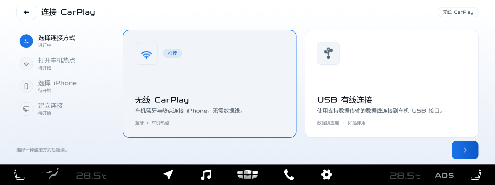

# geely-carplay

面向吉利 GKUI 1.2 / Android 4.3 的 CarPlay 接收端，保留 XML + Kotlin 界面，接入 DiPlay 真实连接、投屏、音频和触摸处理层。2026-11-24 已在吉利 2019 款星越 300T 实机验证热点、Wi-Fi 连接、CarPlay 画面与触摸、音乐与导航独立音量、断开清理与通话切换。

## 文档入口

| 文档 | 用途 |
| --- | --- |
| [AGENTS.md](AGENTS.md) | AI 工作授权、沟通、验证及设备操作规则 |
| [排障手册](docs/troubleshooting.md) | 热点、蓝牙、音频、黑屏和退出故障 |
| [移植记录](docs/carplay-migration.md) | 来源、源码差异、认证和验收边界 |

截至 2026-11-24：当前为 v1.0.1（versionName 1.0.1）。音乐电流声与主动断开后的残留播放已在实机确认消除；来电自动切换手机蓝牙通话；首页布局、连接前检查、不依赖蓝牙的断开检测与音乐缓冲档位已在小米 MI6 上验收；车机上完成了视频帧池化、5GHz 信道 149 + 802.11n + WMM 与设备在线判断的实机验证。

## 功能特性

- 无线连接：蓝牙 iAP2 配对 + 车机热点（Wi-Fi）承载 AirPlay，iPhone 无需数据线；蓝牙只参与建立连接，连接后关闭手机蓝牙不影响投屏。
- 有线连接：USB + VPN/NCM 数据通道，需在连接页授权本地 VPN。
- 画面与触摸：硬件 H.264 解码，1920×720 画布，等比显示与触摸回传；连接成功且主画面视频参数就绪后自动进入 CarPlay，最多等待 3 秒。
- 音频：音乐 AAC-LC 48 kHz 双声道，导航 Opus；媒体通道不会因焦点被其他应用夺走而静音，导航走车机独立通道可单独调音量；音乐缓冲默认 500 毫秒，可在设置改为 1000 毫秒抵抗 Wi-Fi 抖动；iPhone 连接时自动续播的音乐会被车机暂停一次。
- 会话：前台服务保留连接，连接中可取消，断开、自动连接、开机启动可选；手机无响应约 5 秒自动断开并回到首页，检测不依赖蓝牙；连接过程输出时间线日志，无线连接每 5 秒输出链路诊断；通话接通时自动把投屏页拉回前台（最多尝试 5 次），挂断后由车机恢复原有流程。
- 首页：连接手机与快速连接并排；快速连接复用上次在线设备，设备离线时置灰；在线判断同时看蓝牙设备连接、HFP/A2DP 已连接设备与厂商蓝牙槽位，不要求已连 CarPlay；连接前检查热点与蓝牙，缺失时提示手动开启，右上角显示当前蓝牙通道；会话在线时设备标签显示“当前连接”。
- 显示：宽屏资源（宽 ≥1200dp 且可用高 ≥550dp），控件大小小/标准/大三档，深浅主题。
- 认证：本地 MFi（仓库不含认证资产，需自备）、CH341 USB、I2C、远程认证四种目标。

### 实机验证状态（2026-11-24）

| 项目 | 参数 |
| --- | --- |
| 验证车型 | 吉利 2019 款 星越 300T |
| 车机系统 | GKUI 1.2 / Android 4.3（API 18） |
| 系统版本 | `06.03.08600.H53.00060` |
| 屏幕 | 1920×720，density 160 |
| 辅助验证机 | 小米 MI6 / Android 9，用于界面与连接流程回归 |

- 已实测通过：热点开启、Wi-Fi 连接、CarPlay 画面与触摸、音乐播放（无电流声）、导航独立音量、连接成功自动进入、宽屏布局与控件大小调整、主动断开后无残留播放、来电自动切换手机蓝牙通话。
- 2026-11-24 小米 MI6 验收：首页按钮并排与快速连接置灰、连接前热点/蓝牙检查、断开手机蓝牙后继续投屏、关闭热点后约 5 秒回首页、音乐缓冲 500/1000 档位、CarPlay 设备名“车机”。
- 2026-11-24 星越 300T 验收：视频帧池化后 GC 约 0.17–0.22 次/秒、5GHz 信道 149 + 802.11n + WMM 下音频 `gaps=0`（204 秒窗口）、首页与选择 iPhone 页按蓝牙连接判断在线、离线设备置灰不可点、视频帧率 60fps 档位实测约 55fps。
- 尚未验收：USB 与 H52 真车音频、Siri、车载麦克风、自动暂停续播、通话接通自动拉回投屏、导航 Opus 缺口隐藏。

## 实机界面



连接页：左侧步骤栏、右侧连接方式卡片，主操作按钮位于面板下方。

## 软件架构

| 模块 | 职责 |
| --- | --- |
| `app` | 界面、启动初始化、会话管理、前台服务、设置及日志 |
| `shared` | 协议、传输、网络、媒体、JNI 和设备兼容 |
| `vendor/jmdns` | 带 Android 4.3 兼容修复的 Bonjour |

包名 `com.geely.carplay.ui`，minSdk/targetSdk 均为 18，compileSdk 37，Java 目标 11，启用 multidex。Kotlin 使用 AGP 内置支持。

## 快速开始

依赖：JDK 17+、Gradle 9.5.0、AGP 9.3.0、SDK 37、NDK 28.2.13676358。通过 `local.properties` 或 `ANDROID_HOME` 指定 SDK。新环境需先安装工具和下载依赖；离线构建要求缓存齐备。

```bash
./gradlew :app:assembleDebug --offline --console=plain
```

APK：`app/build/outputs/apk/debug/geely-carplay-v<版本>.apk`（当前 v1.0.1）。仓库**不包含** Apple MFi 认证资产，构建前需自备 `app/src/main/assets/offline-mfi/identity.pk8` 与 `certificate.p7b`；缺少时仍可编译，但本地 MFi 认证不可用。GitHub Releases 提供预构建安装包。

## 使用指南

1. 用户手动安装并启动。启动页约 1.8 秒后进首页，不再自动开启热点或蓝牙，请在车机系统设置中手动开启。
2. 在车机系统设置开启热点。若车机保存的是 5 GHz 配置导致热点起不来，应用连接时会改用 2.4 GHz；系统读取配置受限时，可在连接页填写与系统一致的名称和密码。
3. 首页点“连接手机”选择已配对 iPhone，或点“快速连接”直接连上次设备。快速连接要求上次设备在线，离线时按钮置灰；两个入口都会先检查热点，系统蓝牙模式还检查蓝牙，未开启时提示手动打开。
4. 连接成功后自动进入 CarPlay 画面；连接失败停留在投屏页，可重新连接。连接中可取消，首帧到达前显示等待提示。
5. 断开手机蓝牙不影响已建立的投屏；手机关闭热点或离开范围后约 5 秒自动断开并回到首页。
6. 普通返回或切页保留后台会话；“退出应用”会断开并结束进程。主动断开后本进程不立即自动重连。

H52 原厂蓝牙需在设置显式开启后重新选设备；普通手机没有 H52 OEM 音频能力。手机蓝牙连接车机或音箱时，输出仍受 Android A2DP 路由影响，不能把 H52 路由开关理解成向远端车机发送声音。

连接设置通常重连后生效，主题可立即同步。诊断分组里的“详细日志”开关切换后立即生效，默认关闭时 logcat 不含触摸报文、RTSP 收发摘要与 iAP2 逐帧 trace。音乐缓冲默认 500 毫秒，仍卡顿时改为 1000 毫秒，代价是延迟增加。设置可导出诊断报告，界面显示保存位置。`docs/screenshots/` 中 01–05、07–10 为 2026-11-24 模拟器运行截图，06/11/12 为连接成功状态界面，`20-unit-connect.png` 为 2026-11-24 车机实拍。

## 来源与许可

处理层来源：[DiPlay-Geely-Android43](https://github.com/xikai6282/DiPlay-Geely-Android43)。保留 LICENSE、源文件标记及 libopus、Concentus、JmDNS、BouncyCastle 等第三方声明。详细来源和差异见移植记录。
